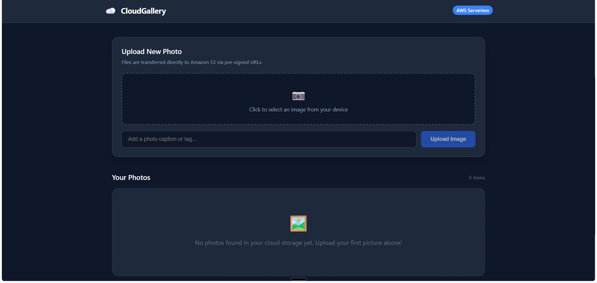

# Serverless Cloud Photo Gallery

A full-stack, cloud-native photo gallery web application utilizing an AWS serverless architecture and React frontend.

## Architecture & Workflow
- **Frontend**: React (TypeScript + Vite)
- **Direct-to-S3 Uploads**: AWS S3 Pre-signed URLs for optimized client uploads without intermediary compute overhead.
- **Backend Services**: AWS Lambda (Node.js 18+) via API Gateway.
- **Database**: AWS DynamoDB for image metadata, captions, and user sorting.
- **Storage**: Amazon S3 for secure asset management.
- 
